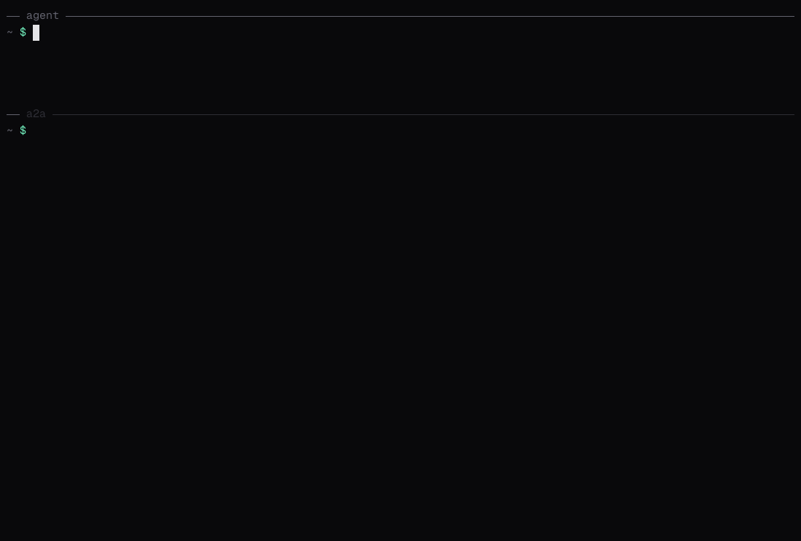

# A2A CLI

<div align="center">
  
</div>

<p align="center">
  <a href="https://a2aproject.github.io/a2a-cli/"></a>
  <a href="https://github.com/a2aproject/a2a-cli/releases/latest"></a>
  <a href="./LICENSE"></a>
</p>

`a2a` is the official command-line client for [A2A (Agent2Agent)](https://a2a-protocol.org) agents. It discovers agents, sends them messages and files, streams their replies and manages their tasks over JSON-RPC, REST, gRPC or a transport you plug in. People, scripts and coding agents use the same commands.

<p align="center">
  
</p>

- **Talk to any agent:** find it in an [AI Catalog](./docs/guide/ai-catalogs.md), read its [agent card](./docs/guide/agent-cards.md), send [text, files and data](./docs/guide/messages.md), [stream](./docs/guide/streaming-and-async.md) replies and hold [conversations](./docs/guide/conversations.md).
- **Script it:** [JSON output and distinct exit codes](./docs/guide/scripting.md), [async tasks](./docs/guide/tasks.md) and [push notifications](./docs/guide/push-notifications.md).
- **Give it to your coding agent:** the [a2a-cli skill](./docs/guide/coding-agents.md) teaches Claude Code, Cursor or Codex to hand work to A2A agents.
- **Fit it to your setup:** [configuration](./docs/guide/configuration.md) from flags, variables and files, [credential helpers](./docs/guide/credentials.md), and [plugins](./docs/guide/plugins.md) for new commands and transports.

Built on [A2A Protocol v1.0](https://a2a-protocol.org/v1.0.0/specification/), and speaks v0.3 too.

## Quickstart

Install on macOS or Linux:

```bash
brew tap a2aproject/a2a-cli https://github.com/a2aproject/a2a-cli
brew install a2a
```

On Windows, `winget install a2aproject.a2acli`. [Getting Started](./docs/getting-started.md#install) lists the other ways, including an install script and `go install`.

Talk to an agent:

```bash
a2a card get https://agent.example.com                  # what can it do?
a2a send -a https://agent.example.com "Summarize this"  # ask and wait
a2a send -a https://agent.example.com --stream "..."    # watch it work
```

No agent yet? [a2a-serve](https://github.com/a2aproject/a2a-serve) serves Claude Code, opencode or any ACP coding agent as an A2A agent. [Getting Started](./docs/getting-started.md) sets one up.

## Agent Skill

The [a2a-cli Agent Skill](./skills/a2a-cli/SKILL.md) teaches coding agents to drive `a2a`. Install it with [`skills`](https://www.skills.sh):

```bash
npx skills add https://github.com/a2aproject/a2a-cli --skill a2a-cli
```

It also ships as an [Agent Plugin](https://agent-plugins.org/) in the [a2aproject/agent-plugins](https://github.com/a2aproject/agent-plugins) marketplace. [Coding agents](./docs/guide/coding-agents.md) has the details.

## Documentation

The full documentation is at **[a2aproject.github.io/a2a-cli](https://a2aproject.github.io/a2a-cli/)**.

| Section | For |
|---|---|
| [User Guide](./docs/guide/agent-cards.md) | A short page on each task. |
| [Lessons](./lessons/README.md) | A recorded, step-by-step course from your first message to credentials. |
| [Examples](./examples/README.md) | Recipes to copy: scripting with `jq`, a credential helper, plugins. |
| [Advanced](./docs/advanced/architecture.md) | How discovery, streaming, credential helpers and plugins work inside. |
| [Reference](./docs/reference/commands/a2a.md) | Every command, flag, configuration key, output format and exit code. |

## Contributing

We welcome issues and pull requests. Read the [Contributing guide](CONTRIBUTING.md) to get started, and tell us how you use the tool on the [Discord server](https://discord.com/invite/9UpukKSpRN).

This project reconciles the community and SDK A2A CLIs into one standard client, and builds on the CLI from the [A2A Go SDK](https://github.com/a2aproject/a2a-go).

## License

The A2A CLI is licensed under the [Apache License 2.0](LICENSE).
