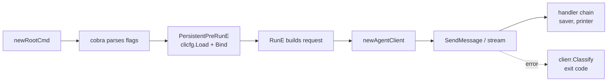

# Architecture

The `a2a` CLI is a thin layer over the [a2a-go](https://github.com/a2aproject/a2a-go) SDK. The SDK owns the protocol: card parsing, interface selection, the JSON-RPC, REST and gRPC clients, and the event types. The CLI owns argument parsing, configuration, credentials, plugins, output and the process lifecycle. This page follows one command through the code and maps the packages. The rules for laying out new code are in the contributor note [internal/DESIGN.md](../../internal/DESIGN.md).

## Life of a command

`a2a send -a localhost:8080 "hi"` goes through these steps.

1. **Build the command tree.** `main` calls `cli.Execute`, which builds the cobra tree in `newRootCmd` (`internal/cli/root.go`). Before it returns, it loads the configuration once, without `--config`, to read `plugins-enabled`. When that is true, it scans `PATH` and adds a command for each command plugin. See [Command Plugins](command-plugins.md).
2. **Parse flags.** cobra parses the command line.
3. **Load configuration.** The root `PersistentPreRunE` runs before every command. It loads the configuration store again, now with `--config` (`clicfg.Load`), and calls `clicfg.Bind`, which fills each flag of the running command that the command line did not set. It prints a warning for each protected setting it ignored in a discovered `.env`. See [Configuration Layers](configuration.md).
4. **Prepare.** `PersistentPreRunE` then routes HTTP through `--unix-socket` if set, sets up the credential helpers, checks `--output`, and builds the event handler chain.
5. **Build the request.** `send` turns the positional text and the part flags into an `a2a.SendMessageRequest`.
6. **Create the client.** `newAgentClient` (`internal/cli/client.go`) loads `--ca-cert`, resolves the card and builds an `a2aclient.Client`.
7. **Call the agent.** `send` calls `SendMessage`, or `SendStreamingMessage` with `--stream`, and passes each event to the handler chain.
8. **Exit.** The deferred `destroyClient` closes the transport, which also stops a transport plugin process. `Execute` turns an error into a message and an exit code with `clierr.Classify`.

## The client factory

`newAgentClient` takes exactly one of two inputs.

| Input | What happens |
| --- | --- |
| `--agent-card` | `resolveCard` fetches the card with the service parameters and credential helper headers attached. `a2aclient.NewFromCard` picks one of its interfaces, using `--transport` as the preferred order. |
| `--endpoint` | No card. `--endpoint` needs exactly one `--transport`, and `a2aclient.NewFromEndpoints` connects to that one interface. |

Both pass the factory options built in `clientFactoryOpts`:

- The SDK defaults are disabled and the CLI registers its own transports: REST, JSON-RPC and gRPC for protocol v1.0, and the same three through the `a2av0` compatibility layer for v0.3. `--a2a-version 1.0` or `--a2a-version 0.3` registers only one set.
- The REST and JSON-RPC transports share one `http.Client` with no total timeout. The a2a-go default client caps each request at 3 minutes; the CLI leaves the limit to the `--timeout` context. The client's transport is wrapped in `utils.ActivityTransport`, so response bytes reset the streaming inactivity timer. See [Streaming and Timeouts](streaming.md).
- gRPC uses TLS with the system roots, or the roots in `--ca-cert`, or plaintext with `--insecure`, and dials through the socket with `--unix-socket`.
- With credential helpers configured, a call interceptor adds their headers to every call. See [Credential Helpers](credential-helpers.md).
- Transport plugins add factories for the custom bindings the card lists. See [Transport Plugins](transport-plugins.md).

Cards often advertise a gRPC interface with an `http://` or `https://` URL, which `grpc.NewClient` cannot resolve. The CLI's gRPC factory strips the scheme and dials `host:port`. With `--unix-socket` it uses the `passthrough` resolver, since the socket dialer ignores the address. [Discovery and Transports](discovery.md) describes the selection in full.

## Event handlers

Commands that receive events (`send`, `chat`, `task get`, `task subscribe`) pass each one to `globalConfig.handleEvent`, which runs the chain built in `internal/cli/events.go`:

1. With `--save-fileparts`, the file part saver (`internal/fileparts`) writes the raw file parts of the event to disk.
2. The printer (`internal/output`) writes the event in the `--output` format.

`chat` appends a third handler that carries the context and task IDs from one turn to the next. A handler that fails stops the chain and fails the command.

## Errors

Every failure ends as a `clierr.Error` with a code, a message, an optional hint and an exit status. Code that knows the category creates one directly: `clierr.Usage` for bad input and `clierr.CardResolution` for a failed card fetch. `clierr.Classify` sorts any other error: a deadline is a timeout, an `a2a.Error` from the agent is a protocol error, a network failure is an I/O error, and the rest are internal errors. [Errors and Exit Codes](../reference/errors.md) lists the codes.

## Packages

| Package | Responsibility |
| --- | --- |
| `internal/cli` | Cobra commands, one file per command; root setup, the client factory, credential wiring, event handlers |
| `internal/clicfg` | Configuration store over the environment, `.env`, YAML and JSON files; binding to flags; environment for transport plugins |
| `internal/clierr` | Error codes, exit statuses, classification, URL redaction |
| `internal/flagparse` | Flag value types: card reference, message parts, metadata, service parameters, transports, task states |
| `internal/output` | Text and JSON rendering of cards, tasks, messages, events and lists |
| `internal/polling` | Polling fallback for `--stream`, and `task get --wait` |
| `internal/chat` | The interactive session: turns, identifiers, interrupts |
| `internal/credhelper` | Credential helper protocol, scope selection, caching, the call interceptor |
| `internal/fileparts` | Writes raw file parts to the `--save-fileparts` directory |
| `internal/transportplugin` | Finds and launches `a2a-transport-*` plugins; the proxy transport |
| `internal/commandplugin` | Finds and runs `a2a-*` command plugins |
| `internal/cacert` | Loads the `--ca-cert` file |
| `internal/unixsocket` | HTTP transport and gRPC dialer for `--unix-socket` |
| `internal/utils` | Inactivity timeout and activity transport |
| `internal/clidoc`, `internal/tools/gendocs` | Generate the [command reference](../reference/commands/a2a.md) |
| `devkit/cliplugin` | Public helpers for writing command plugins |
| `devkit/clitransport` | Public helpers for writing transport plugins: loopback server, handshake, token check |
| `skills` | The agent skill that `a2a skill` prints |

## Design notes

- **Configuration is loaded twice.** `plugins-enabled` decides which commands exist, so it must be known before cobra parses anything. `--config` is a flag, so the full load waits until flags are parsed.
- **The CLI registers its own transports.** It needs one HTTP client for all of them, without the SDK's 3-minute cap and with activity tracking, and it needs the v0.3 transports alongside the v1.0 ones.
- **Plugins are separate programs.** New commands and bindings need no rebuild of the CLI, and a plugin can be written in any language.
