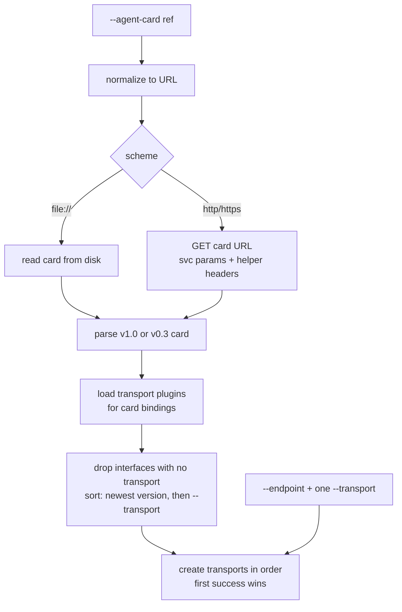

# Discovery and Transports

Before it can send anything, the CLI turns the `--agent-card` reference into a URL, fetches the card, and picks one of the interfaces the card lists. With `--endpoint` it skips the card and connects to the one interface you name. This page describes each step and the rules behind it. The [Agent Cards](../guide/agent-cards.md) and [Transports](../guide/transports.md) guides cover everyday use.



## Reference normalization

`--agent-card`, the `card get` argument and the `auth get` argument accept a host, a URL or a file path. `flagparse.URLOrPath` (`internal/flagparse/urlorpath.go`) normalizes the value with these rules, in order:

| Reference | Becomes | Example |
| --- | --- | --- |
| Contains `://` | Used as is | `https://agent.example.com/card.json` |
| Starts with `/`, `./` or `../`, or names an existing file or directory | `file://` with the absolute path | `./card.json` → `file:///home/me/card.json` |
| `localhost` or a loopback IP, with an optional port | `http://` + reference | `localhost:8080`, `127.0.0.1:9000`, `[::1]:8080` |
| Anything else | `https://` + reference | `agent.example.com` |

The loopback check looks at the whole reference when it has no port, so a loopback host followed by a path gets `https://`: `localhost/card.json` becomes `https://localhost/card.json`, while `localhost:8080/card.json` becomes `http://localhost:8080/card.json`. Pass the scheme to be sure.

Before the fetch, the reference is validated: a file must exist, and a URL must have a host. Both failures are usage errors (exit 2).

A `urn:` reference, or any reference with `--catalog`, skips these rules: it is an identifier looked up in [AI Catalogs](../guide/ai-catalogs.md), unless a file with that name exists. A URL that serves a catalog in place of a card resolves to the catalog's only A2A agent.

## Card resolution

The a2a-go card resolver (`agentcard.Resolver`) fetches the card:

| URL | Request |
| --- | --- |
| No path, or `/` | `GET <origin>/.well-known/agent-card.json` |
| Any other path | `GET` of the URL as given |
| `file://` | Reads the file; request headers are ignored. The host must be empty or `localhost`. |

A response other than `200 OK` fails with exit code 4, and so does a body that is not a card. The hint for 401 and 403 suggests credentials, and the hint for 5xx suggests the agent's logs. A network failure exits 3 and a timeout exits 5. See [Errors and Exit Codes](../reference/errors.md).

The card request uses the same HTTP transport as A2A calls, so `--unix-socket` and `--ca-cert` apply to it, and `--timeout` bounds it.

The CLI sets the resolver's parser to the `a2av0` card parser, which reads both formats. A card with `supportedInterfaces` is a v1.0 card and is used as is. A v0.3 card is converted: its `url` and `preferredTransport` become the first interface, each `additionalInterfaces` entry with a different URL becomes another, and every interface takes the card's `protocolVersion` (default `0.3`).

### Headers on the card request

The card request carries:

1. Every `--svc-param` and `--auth` value as an HTTP header. Repeated values for one key are joined with `, `.
2. For an `http` or `https` reference, the headers of the [credential helper](credential-helpers.md) selected for the reference as given (`--agent-card` or the positional URL). A header that `--auth` or `--svc-param` already sets is not overridden.

A gateway in front of the agent then sees the same credentials on the card request as on the A2A calls.

## Interface selection

`newClientFromCard` passes the card to `a2aclient.NewFromCard`. The selection happens in a2a-go (`a2aclient/factory.go`, `selectTransport` and `createTransport`):

1. **Match a transport.** Each interface is matched to a registered transport by binding and protocol version. Without an exact version match, a transport for the same binding with the same major version is used, so a `0.3.0` interface uses the v0.3 transport. Interfaces with no match are dropped. If none remain, the command fails with `no compatible transports found` and lists the card's `BINDING_version` pairs.
2. **Sort.** The newest protocol version comes first. Within one version, interfaces follow the order of `--transport`, and interfaces whose binding is not in `--transport` keep the card's order after them.
3. **Create.** The transports are created in that order, and the first one created without error is used. The others are logged to stderr at INFO level.

Some consequences:

- `--transport` orders interfaces within a protocol version. It does not move a v0.3 interface ahead of a v1.0 one.
- `--transport` values not on the card have no effect in card mode.
- Creating an HTTP or gRPC transport opens no connection, so a fallback to the next interface happens when creation fails, such as a transport plugin that does not start. An agent that is down fails on the first call.
- The SDK sends the selected protocol version in the `A2A-Version` service parameter.
- `--tenant` is set on every request. Without it, the selected interface's `tenant` is used.

### Registered transports

`clientFactoryOpts` registers these transports, depending on `--a2a-version`:

| `--a2a-version` | Registered |
| --- | --- |
| unset | REST, JSON-RPC and gRPC for v1.0 and for v0.3 |
| `1.0` | REST, JSON-RPC and gRPC for v1.0 |
| `0.3` | REST, JSON-RPC and gRPC for v0.3 |
| any other value | No built-in transport; only transport plugins |

Against a card that lists only v1.0 interfaces, `--a2a-version 0.3` fails:

```text
Error: failed to create a client: no compatible transports found: available transports - [JSONRPC_1.0,HTTP+JSON_1.0]
```

`--transport` accepts `rest`, `jsonrpc` and `grpc` in any case, which map to the bindings `HTTP+JSON`, `JSONRPC` and `GRPC`. Any other value is a custom binding name and is kept as typed.

## Direct endpoints

`--endpoint <url>` skips the card. It needs exactly one `--transport`; zero or several are a usage error. The CLI builds one interface from the URL and the binding with protocol version `1.0`, or the `--a2a-version` value, and connects to it with `a2aclient.NewFromEndpoints`.

`--endpoint` and `--agent-card` together are a usage error. Without a card, `send --stream` cannot check the card's streaming capability, so it tries to stream and falls back to polling only when the agent rejects it. See [Streaming and Timeouts](streaming.md).

## Custom bindings

A binding other than `JSONRPC`, `HTTP+JSON` and `GRPC` needs a transport plugin, a program named `a2a-transport-<binding>` (lowercased) on `PATH`:

- With `--endpoint`, the plugin for `--transport` must exist. Otherwise the command fails and lists the plugins it found:

  ```text
  Error: failed to create a client: no transport plugin "nosuch" found on PATH (expected a "a2a-transport-nosuch" binary); available plugins: [echo]
  ```

- With a card, `transportplugin.LoadForCard` looks up a plugin for every binding the card lists and registers each one it finds for protocol v1.0. Bindings with no plugin are skipped, and step 1 above drops their interfaces.

`LoadForCard` also looks up plugins for the built-in bindings. A program named `a2a-transport-jsonrpc`, `a2a-transport-grpc` or `a2a-transport-http+json` on `PATH` replaces the built-in v1.0 transport for that binding whenever a card lists it. [Transport Plugins](transport-plugins.md) describes how a plugin runs.
