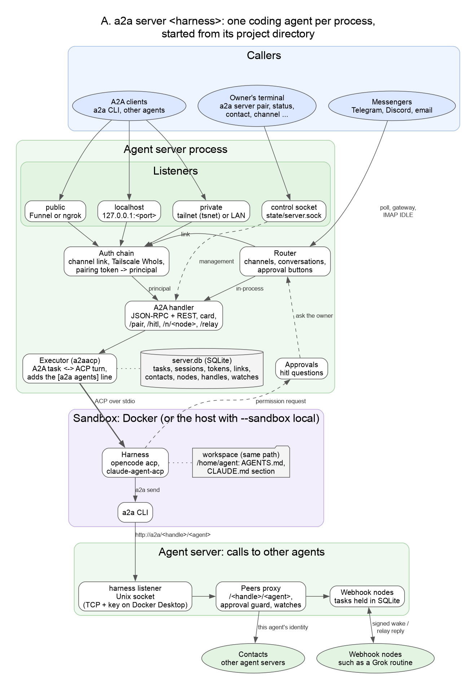
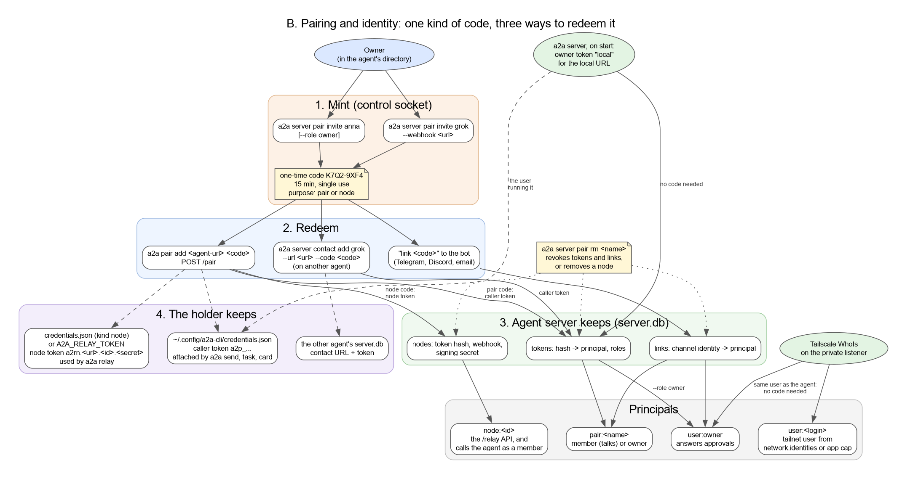
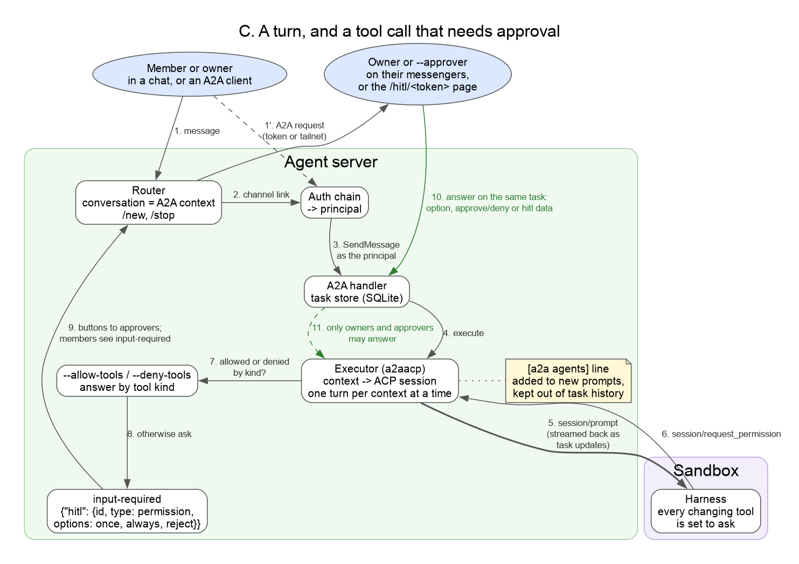
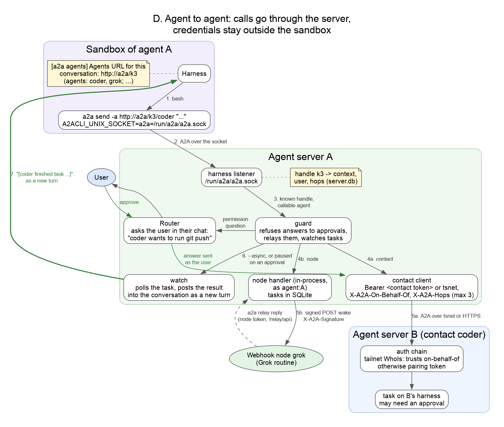

# Agent server: summary and architecture

> [!WARNING]
> Alpha. This describes the current design; it may change.

How to use it is in the [agent server guide](agent-server.md). This page is
about how it works.

## Summary

`a2a server <harness>` turns a coding agent that speaks the
[Agent Client Protocol](https://agentclientprotocol.com) (opencode, Claude
Code, or any `--command`) into an A2A agent:

- **One agent per process, per directory.** The agent is its project
  directory: `.a2a/config.yaml` holds its definition and `.a2a/state/` its
  database, secrets, network identity and harness home. Management commands
  find it the way git finds a repository and talk to it over a control socket.
- **Sandboxed.** The harness runs in Docker as your user, with the workspace
  mounted at its own path. Every tool call that changes something asks first.
- **Reachable.** Over A2A on localhost, on a private network (its own tailnet
  machine through tsnet, or the LAN), on a public URL (Funnel or ngrok), and
  from Telegram, Discord and email. A chat thread is an A2A context.
- **Paired, not configured.** Access is a one-time code from the owner, which
  becomes a token, a messenger link, a contact or a webhook node. On the
  tailnet your own machines need no code.
- **Approvals stay with people.** A tool call pauses the task in
  `input-required`; the owner or an approver answers, from any messenger.
- **Agents call agents through the server.** The harness uses the `a2a` CLI
  against `http://a2a/<handle>/<agent>`. The server makes the call with its
  own identity, relays the other agent's approvals to the user, and posts late
  results back into the conversation. Credentials never enter the sandbox.
- **Webhook nodes.** Agents that only run when woken, such as a Grok routine,
  get an A2A address on the server, which holds their tasks and wakes them
  with signed POSTs.

## A. Components



| Component | What it does | Code |
| --- | --- | --- |
| Listeners | localhost, private (tsnet or LAN with mDNS), public (Funnel or ngrok), the control socket, and the harness listener. | `internal/network`, `agentsrv/netsetup.go`, `agentsrv/control.go` |
| Auth chain | Turns a request into a principal: a channel link, Tailscale `WhoIs` on the private listener, or a pairing token. | `internal/auth` |
| A2A handler | JSON-RPC and REST, the agent card, `/pair`, `/hitl/<token>`, `/n/<node>`, `/relay/api`. Tasks are stored in SQLite. | `agentsrv/http.go`, `internal/store` |
| Router | Runs the messenger channels, maps a conversation to an A2A context, renders streaming answers and approval buttons. | `agentsrv/router.go`, `internal/channel/*` |
| Executor | `a2aacp` from a2a-go: one ACP session per A2A context, task updates from ACP notifications, permission requests as `hitl` questions. The server wraps it to add the `[a2a agents]` line. | `agentsrv/executor.go`, `agentsrv/instructions.go` |
| Sandbox | `docker run` with the workspace, `state/home` as `/home/agent`, dropped capabilities and limits; or the host with `--sandbox local`. Images are pulled, or built from Dockerfiles in the binary. | `internal/harness` |
| Peers proxy | Serves contacts and nodes to the harness as A2A agents under `/<handle>/<agent>`, guards approvals, watches tasks. | `agentsrv/agents.go`, `agentsrv/peers.go` |
| Webhook nodes | A2A agents whose tasks the server holds; it wakes them with signed POSTs, and they answer through the relay API. | `agentsrv/nodes.go`, `internal/relayapi` |
| CLI | `a2a server ...` on the server side, `a2a pair` and `a2a relay` on the caller and node side. | `internal/cli` |

The state is all in the agent directory:

```
.a2a/
├── config.yaml        # flags of the first run; secrets as secret:NAME references
└── state/
    ├── server.db      # tasks, ACP sessions, tokens, links, contacts, nodes, handles, watches
    ├── secrets        # mode 0600
    ├── tsnet/         # the agent's tailnet machine
    ├── home/          # the harness's /home/agent
    ├── harness/a2a.sock
    └── server.sock
```

## B. Pairing and identity



Every way in starts with a code minted over the control socket, so only
someone with access to the agent directory can hand out access.

- **Callers** run `a2a pair add <agent-url> <code>`. The token (`a2p_...`) is
  saved in `~/.config/a2a-cli/credentials.json`, and later `a2a send`,
  `a2a task` and `a2a card` commands attach it for that URL only.
- **Messenger accounts** send `link <code>` to the bot. The server links the
  channel identity to the principal; only verified senders can link (for
  email, DMARC or aligned DKIM from the trusted server).
- **Other agents** redeem a code with `a2a server contact add --url --code`
  and keep the token in their own database. On the same tailnet no code is
  needed: the callee identifies the caller with `WhoIs`.
- **Webhook nodes** redeem a node code with the same `a2a pair add`. Their
  token (`a2rn.<api url>.<id>.<secret>`) carries the agent's URL and only
  opens the `/relay/api`.

Principals are `user:owner`, `pair:<name>` (member or owner role),
`user:<login>` for other tailnet users allowed in `config.yaml`, and
`node:<id>`. `a2a server pair rm <name>` revokes a name's tokens and the
messenger links made with its codes, including links with the owner role, or
removes a node.

## C. A turn



1. A message arrives from a chat (through the router) or as an A2A request.
   The auth chain gives it a principal, which becomes the A2A user.
2. The executor maps the A2A context to an ACP session (kept in SQLite, so
   conversations survive restarts) and sends the message as a prompt. New
   prompts start with the `[a2a agents]` line; answers to the harness's own
   questions don't, because the executor parses them.
3. The harness is configured to ask before every tool call that changes
   something. `--allow-tools` and `--deny-tools` answer by ACP tool kind;
   anything else pauses the task in `input-required` with a `hitl` data part.
4. The owner and approvers get the question with buttons on their
   messengers, or the `/hitl/<token>` page. A member who started the task sees
   `input-required` but can't answer it.

## D. Agent to agent



The harness calls other agents with the plain `a2a` CLI. Everything that
makes the call trustworthy happens in the server:

- **Reaching the server.** The harness listener is a Unix socket, mounted into
  the container at `/run/a2a/a2a.sock` with the server's binary at
  `/usr/local/bin/a2a`. `A2ACLI_UNIX_SOCKET=a2a=<socket>` sends requests for
  the host `a2a` through it and everything else normally. Docker Desktop can't
  mount the socket, so there the listener is TCP and the harness sends a key
  that the server writes into the harness's `a2a` credentials for that URL.
- **Which conversation.** One harness process serves every conversation, and
  a shell command carries nothing that ties it to one. So each prompt's
  `[a2a agents]` line gives a short handle, `http://a2a/k3`, which the server
  maps to the A2A context, the user the turn is for and the hop count. A
  handle is not a secret: only the harness reaches the listener.
- **Making the call.** For a contact, the server resolves its card and calls
  it with its stored token or over tsnet, adding `X-A2A-On-Behalf-Of` and
  `X-A2A-Hops` (at most 3). The callee counts hops from callers it identified
  on the private network, and honors `X-A2A-On-Behalf-Of` only from agents of
  its own owner, because the user it names is in the caller's namespace. A
  node is called in-process.
- **Approvals.** If the called agent asks for an approval, the server relays
  it to the user in the chat they are in, and refuses an answer from the
  harness itself. The user's answer goes to the remote task.
- **Late results.** A task the harness didn't wait for (`--async`, a dropped
  stream, or one paused on an approval) is watched, and its result is posted
  into the conversation as a new turn, so the agent picks it up and tells the
  user.
- **Instructions.** The how-to (`skills/a2a-agents`) and the list of agents
  are kept in a marked section of the harness's global instructions,
  `~/.config/opencode/AGENTS.md` and `~/.claude/CLAUDE.md` in `state/home`.

Webhook nodes are the other direction: the server wakes the node with a POST
signed with `X-A2A-Signature: t=<time>,v1=<HMAC-SHA256 of "<t>.<body>">`, and
the node answers with `a2a relay reply`, which posts events to the task. A
task with no event for 10 minutes fails.

## Design notes

- **Why the CLI instead of MCP tools.** ACP passes nothing per session except
  MCP servers, which needed a Node bridge on Linux and a tool surface the
  harness had to learn. The CLI is already in the sandbox and covers the whole
  protocol (streaming, tasks, follow-ups); the handle carries what the MCP
  session token used to.
- **Why calls go through the server.** The sandbox can't reach the tailnet,
  which runs inside the server process, and shouldn't hold contact tokens.
  Going through the server also keeps approvals with people and lets late
  results come back.
- **Why one code for everything.** `/pair` redeems caller and node codes
  alike, and `a2a pair add` stores whichever token it gets, so there is one
  command to learn on each side.

Not in this version: an egress proxy and credential injection for the
harness's own network access. API keys passed with `--secret` are visible
inside the container.

## Diagrams

The sources are Graphviz files in [`graphs/`](graphs/). After editing one,
re-render it:

```sh
cd docs/graphs && dot -Tpng -Gdpi=110 agent-server-<name>.dot -o agent-server-<name>.png
```
