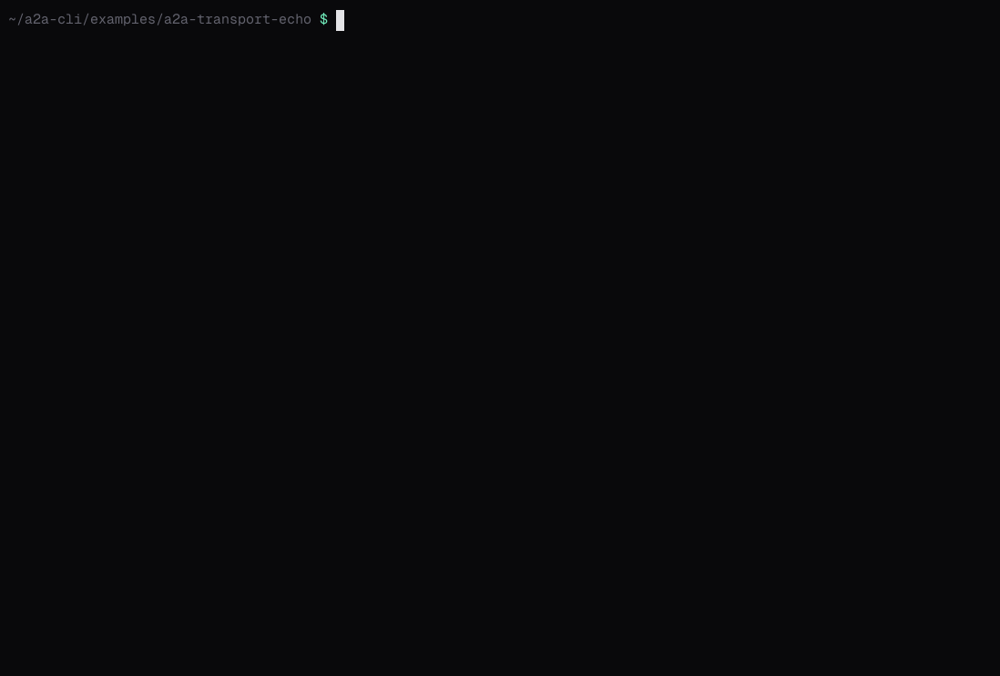

# A Transport Plugin

`a2a-transport-echo` adds a transport, `--transport echo`, to the CLI without rebuilding it. A real transport plugin connects `a2a` to agents over a protocol it doesn't speak natively, such as a message bus. This one answers locally, echoing each message back as a completed task, so it runs with no agent at all. It's built with the [`clitransport`](../../devkit/clitransport) devkit.



## Build and install

From this directory, build the binary with its required name and put it on your `PATH`:

```bash
go build -o ~/bin/a2a-transport-echo .    # any directory on PATH
```

Transport plugins need no switch: `a2a` starts one when a command asks for its transport.

## Try it

```bash
a2a transport list
```

```text
NAME  VERSION  PROTOCOL  DESCRIPTION                                           PATH
echo  1.0.0    1.0       Echoes the caller's message back as a completed task  /home/you/bin/a2a-transport-echo
```

```bash
a2a send --transport echo --endpoint echo://demo "hello there"
```

```text
Task:     01a1d53e-859e-7b01-9b02-fd404647eba7
Context:  01a1d53e-859e-7b04-b8da-746a1a6a8e73
Status:   completed
Artifacts:
  [01a1d53e-859e-7b06-b1e1-5065c9ac1c51] hello there
History:
  [user] hello there
```

```bash
a2a send --transport echo --endpoint echo://demo --stream "stream me"
```

```text
Task:     01a1d53e-85cf-7ee4-82a0-4d50779014fb
Context:  01a1d53e-85cf-7ee8-9c51-54ee4175308c
Status:   submitted
[status] working
[artifact] stream me
[status] completed
```

An agent card can name the transport too: when a card lists an interface with the binding `echo`, `a2a` uses the plugin for it.

## How it works

For each command, `a2a` starts `a2a-transport-echo serve --endpoint echo://demo`. The plugin starts an A2A server on a loopback port, speaking one of the standard bindings, and prints one JSON line with its address, a one-time token and a TLS certificate. `a2a` connects to it as to any agent, and the plugin forwards every call to its own transport. When the command ends, `a2a` closes the plugin's stdin and it shuts down.

The devkit does all of that. A plugin supplies an [`a2aclient.Transport`](https://pkg.go.dev/github.com/a2aproject/a2a-go/v2/a2aclient#Transport):

- [`main.go`](main.go) hands the transport to `clitransport.Main`, with the name, version and description that `transport list` shows.
- [`echo.go`](echo.go) is the transport: `SendMessage` returns a completed task with the message's text as its artifact, and `SendStreamingMessage` yields the same task as a stream of events.

[Transport plugins](../../docs/advanced/transport-plugins.md) explains the design, and the [transport plugin protocol](../../docs/reference/transport-plugin-protocol.md) specifies it for plugins written in other languages.
