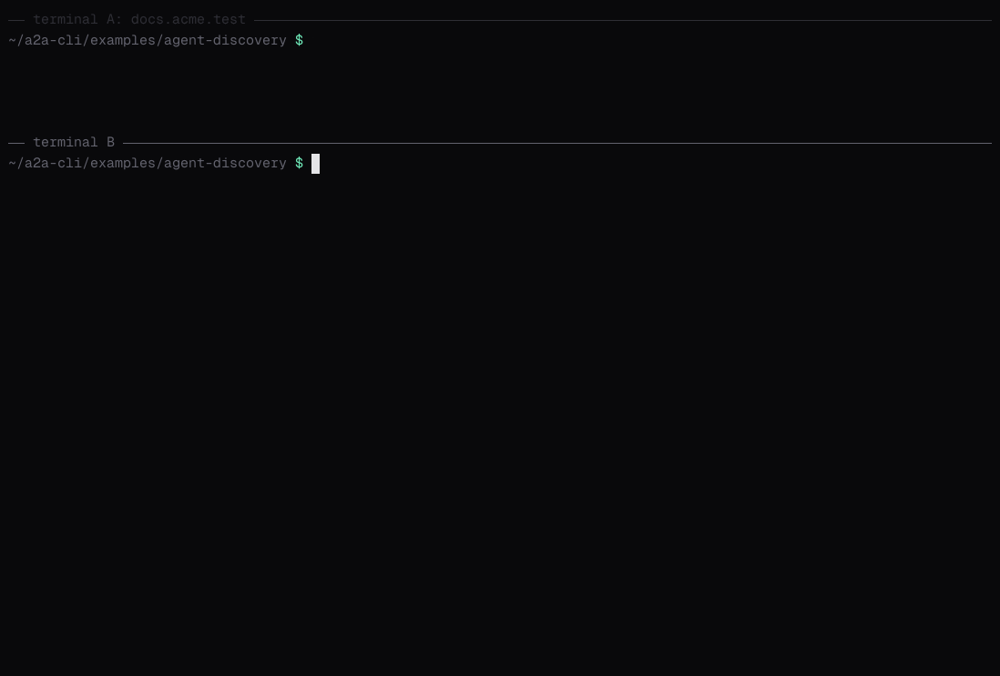

# Agent Discovery

Sites can publish an A2A agent at `/.well-known/agent-card.json`. With the a2a-cli plugin, your coding agent learns about the agent of a site when that site comes up in the conversation, and asks you before it delegates to it. This example serves a made-up documentation site with an agent at `docs.acme.test`, and asks [opencode](https://opencode.ai) a question about it.



## Prerequisites

- `a2a`, Go and Docker, as in [opencode Calls a Contact](../opencode-contacts/README.md), whose [`run-opencode`](../opencode-contacts/run-opencode) this example uses.
- A [Gemini API key](https://aistudio.google.com/apikey) in `GEMINI_API_KEY`.

Run the commands in this directory. Serve the site in a second terminal:

```bash
go run ./site --addr 127.0.0.1:8080 --url http://docs.acme.test:8080
```

[`site/main.go`](site/main.go) serves three things: a page about the rate limits of the "Acme Payments API" that leaves out the retry policy, an agent card for the "Acme Docs Assistant" with a skill for exactly that, and the agent. The agent has no model and gives the same answer every time.

## Point a name at the site

Discovery works on real host names, so give the site one. Outside Docker, add it to `/etc/hosts`:

```bash
echo "127.0.0.1 docs.acme.test" | sudo tee -a /etc/hosts
```

`run-opencode` runs opencode in a container, which takes the name from `--add-host` instead:

```bash
export OPENCODE_DOCKER_ARGS="--add-host docs.acme.test:127.0.0.1"
```

## Ask opencode

```bash
../opencode-contacts/run-opencode run "Read http://docs.acme.test:8080/ and tell me how my client should handle 429s from the Acme Payments API."
```

opencode fetches the page. The plugin sees the URL, finds the site's agent card, and adds it to the fetch result as an unverified agent. The page doesn't have the answer, so opencode offers the agent and asks first:

```text
% WebFetch http://docs.acme.test:8080/

I found that the Acme Payments API returns HTTP 429 when rate limits are exceeded, but the specific retry
policy and idempotency rules are not listed directly on the documentation page.

The site provides an **Acme Docs Assistant** (an A2A agent) to answer these questions. Would you like me to
ask it how your client should handle 429s?
```

Say yes, in the same session:

```bash
../opencode-contacts/run-opencode run --continue "Yes, ask it."
```

```text
$ a2a send -a http://docs.acme.test:8080 "How should my client handle 429s from the Acme Payments API?"
Status:   completed (2026-11-16T10:51:09Z)
Artifacts:
  [01a1e3fb-73ec-7b73-b5b7-ed151d7ef1fe] Retry 429 responses from the Acme Payments API like this:

1. Wait for the number of seconds in the Retry-After header before the next attempt.
2. Without the header, back off exponentially from 1s, doubling up to 32s, with jitter.
...
```

The site's terminal shows the probe of the agent card, then the A2A request.

## How it works

When a URL appears in a prompt or a web fetch, the plugin runs `a2a hook`, which checks the card cache for the URL's origin. An origin it hasn't seen is probed by a detached `a2a hook probe`, which fetches `/.well-known/agent-card.json`; for a web fetch the plugin waits briefly for the probe, so the agent arrives with the fetch result. Each agent is reported once per session.

Discovered agents are marked unverified: the context tells opencode to ask you before delegating or sending data to them, and to treat the card's text as data, not instructions. To trust one, save it as a contact with `a2a contact add acme-docs http://docs.acme.test:8080`.

[Coding Agents](../../docs/guide/coding-agents.md#contacts-and-agent-discovery) describes discovery and its settings, and [Security](../../docs/advanced/security.md#agent-discovery) where probes may connect. Set `discovery: false` in `~/.config/a2a-cli/config.yaml` to turn it off.

## Clean up

Stop the site with Ctrl-C, remove the `/etc/hosts` line if you added it, and remove the volumes `run-opencode` created:

```bash
docker volume rm a2a-example-opencode-data a2a-example-opencode-cache
```
