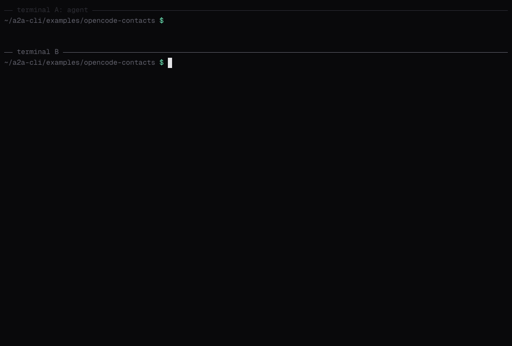

# OpenCode Calls a Contact

Save an agent as a contact, and your coding agent knows to delegate to it. This example runs [opencode](https://opencode.ai) with the a2a-cli plugin for opencode: the plugin tells opencode about your contacts at the start of each session, and opencode calls them with `a2a send`.



## Prerequisites

- `a2a`, Go and Docker. [`run-opencode`](run-opencode) runs opencode in a container from the `ghcr.io/a2aproject/harness-opencode` image, with an `a2a` built from this checkout and the plugin mounted in.
- A [Gemini API key](https://aistudio.google.com/apikey) in `GEMINI_API_KEY`. [`opencode.json`](opencode.json) picks `google/gemini-3-flash-preview` and lets opencode run `a2a` without asking.

Run the commands in this directory. Start the agent in a second terminal:

```bash
./start-agent.sh
```

It runs a "Release Notes" agent on port 9201. To keep the example reproducible it has no model: [`release-notes.awk`](release-notes.awk) turns the `feat` and `fix` commits in a message into notes.

## Add the contact

```bash
a2a contact add release-notes localhost:9201 --note "Use for any release notes or changelog text"
```

```text
Added contact release-notes: Release Notes (urn:ai-catalog:a2a-cli:release-notes)
```

The note goes to your coding agent with the contact, so use it to say when the agent should delegate.

## Ask opencode

opencode knows the contact from the start of the session:

```bash
./run-opencode run "Which A2A agents can you delegate to?"
```

```text
I can delegate to the following A2A agent:

- **release-notes**: Writes user-facing release notes from a list of commits in the team's house style. (Use for any release notes or changelog text).
```

Ask for release notes, and opencode sends the commits in [`commits.txt`](commits.txt) to the contact:

```bash
./run-opencode run "Write release notes for the commits in commits.txt."
```

```text
$ a2a send -a release-notes "Write user-facing release notes for the following commits:
a41c2e9 feat(contact): save trusted agents under a short name
..."
Status:   completed (2026-11-16T10:48:29Z)
Artifacts:
  [01a1e3f9-01ad-7dcc-aece-17d38d6cb8e9] ## What's new

- Save trusted agents under a short name.
- Keep the user config error when the hook can't read it.
- Search registered AI Catalogs.

Thanks to everyone who reported issues.
```

## Use the plugin with your own opencode

The plugin is [`agent-plugin/ai.opencode/plugins/a2a-hook.js`](../../agent-plugin/ai.opencode/plugins/a2a-hook.js). opencode loads plugins from `~/.config/opencode/plugins/`, so copy it there:

```bash
mkdir -p ~/.config/opencode/plugins
cp ../../agent-plugin/ai.opencode/plugins/a2a-hook.js ~/.config/opencode/plugins/
```

It needs `a2a` on the `PATH` opencode runs with.

## How it works

opencode has no command hooks, so the plugin runs `a2a hook` from opencode's plugin events, the same command the Claude Code plugin registers. On the first message of a session it asks for the `SessionStart` context, which lists your contacts with their cards and notes, and adds it to the message. On every message it also asks for the `UserPromptSubmit` context, which lists agents found on sites in the prompt ([Agent Discovery](../agent-discovery/README.md) shows that part).

The contact list says the agents are trusted and how to call them, so opencode runs `a2a send -a release-notes` on its own. [Coding Agents](../../docs/guide/coding-agents.md#contacts-and-agent-discovery) describes the context, and [Contacts](../../docs/guide/contacts.md) the contact book.

## Clean up

```bash
a2a contact remove release-notes
docker volume rm a2a-example-opencode-data a2a-example-opencode-cache
```
