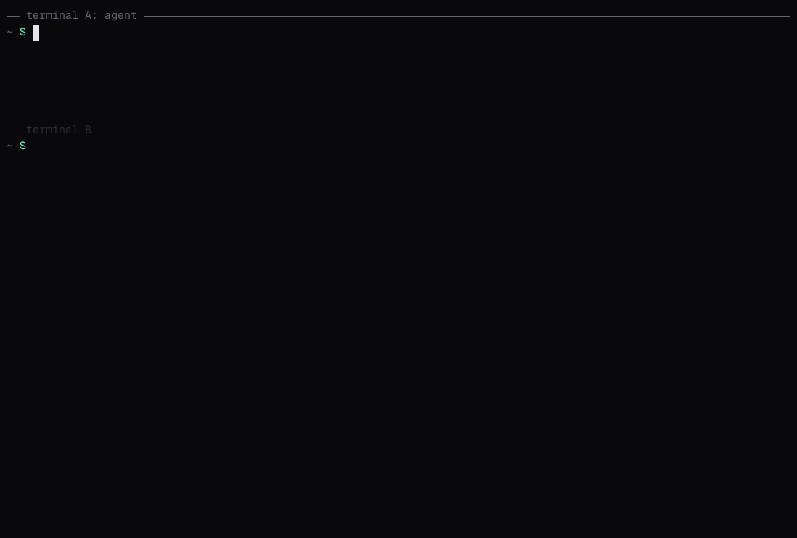

# Lesson 1: Your First Message

In this lesson you start an agent, ask it what it is, send it a message and watch it work. By the end you will know what an agent card is, what a task is, and how to stop typing the agent's address.



## What you'll learn

- How to start an A2A agent with a2a-serve
- What an agent card holds, and how `a2a` finds it from a bare address
- What a task is, and how to read the output of `a2a send`
- How `--stream` shows the agent's progress
- How to keep the agent's address in a `.env` file

## Prerequisites

Everything in [What you need](../README.md#what-you-need). Open two terminals: **terminal A** for the agent and **terminal B** for `a2a`.

## Step 1: Start an agent

An A2A agent is a server that accepts tasks over the [A2A protocol](https://a2a-protocol.org). a2a-serve turns a coding agent into one. In **terminal A**, give it an empty workspace and start it:

```bash
mkdir -p ~/a2a-lessons/agent && cd ~/a2a-lessons/agent
a2a-serve start opencode --name lesson-agent \
  --model openrouter/~google/gemini-flash-latest --secret OPENROUTER_API_KEY
```

a2a-serve prints where it listens:

```text
✓ local    http://127.0.0.1:43229
→ call it from this machine: a2a send -a http://127.0.0.1:43229 "…"
```

Leave it running. The rest of the lesson happens in **terminal B**.

## Step 2: Read the agent card

Before you send an agent work, you want to know what it is and how to reach it. Every A2A agent answers both questions with an **agent card**. In **terminal B**:

```bash
mkdir -p ~/a2a-lessons && cd ~/a2a-lessons
AGENT="$(a2a-serve status --dir agent --url=local)"
a2a card get "$AGENT"
```

```text
Name:         lesson-agent
Description:  lesson-agent is an opencode coding agent reached through `a2a-serve`. Tool calls may pause a task in input-required until whoever started it answers.
Version:      1.0.0
Interfaces:
  JSONRPC (A2A v1.0)     http://127.0.0.1:43229
  HTTP+JSON (A2A v1.0)   http://127.0.0.1:43229
Streaming:    true
Skills:
  coding               Coding agent
```

You gave `a2a` a bare address with no path, so it fetched `http://127.0.0.1:43229/.well-known/agent-card.json`, the place every A2A agent serves its card. The card says:

- **Interfaces**: the URLs and protocols the agent accepts. This one speaks JSON-RPC and REST, both in A2A version 1.0. `a2a` picks one for you.
- **Streaming**: the agent can send progress as it works.
- **Skills**: what the agent offers. Agents with several skills list each here.

Add `-o json` to see the whole card, including fields the text view leaves out:

```bash
a2a card get "$AGENT" -o json
```

## Step 3: Send a message

```bash
a2a send -a "$AGENT" "In one sentence, what can you do?"
```

```text
Task:     01a1d530-3d41-7075-bda9-a201e3d486e3
Context:  01a1d530-3d41-7165-85f7-1902789752d6
Status:   completed (2026-11-13T13:54:30Z)
Artifacts:
  [response] I can read, write and run code in this workspace.
```

Your message started a **task**: a unit of work with an ID, a status and results. `a2a send` waited until the task finished, then printed it:

- **Task** is the task's ID. You use it to look the task up or answer its questions.
- **Context** is the conversation the task belongs to. Lesson 4 uses it.
- **Status** is where the task ended, here `completed`.
- **Artifacts** are the results. a2a-serve names the agent's answer `response`.

## Step 4: Watch it work

A task can take a while. `--stream` prints each event as the agent sends it:

```bash
a2a send -a "$AGENT" --stream "List the files in your workspace."
```

```text
Task:     01a1d530-5355-76ef-bac5-dbeda9bdf0d8
Context:  01a1d530-5355-778d-9be0-4f020a4b0e84
Status:   submitted
History:
  [user] List the files in your workspace.
[status] working
[status] working: Running list files {"toolCall":{...}}
[status] working: Finished list files {"toolCall":{...}}
[artifact] The workspace is empty.
[status] completed
```

First comes the task as the agent accepted it, `submitted`, with your message in its history. Then `[status]` lines report progress, such as the tools the agent runs, and `[artifact]` lines carry the answer as it is written.

## Step 5: Stop typing the address

`a2a` reads settings from a `.env` file in the working directory or above it. Save the agent there:

```bash
echo "A2ACLI_AGENT_CARD=$AGENT" > .env
a2a send "Thanks!"
```

`A2ACLI_AGENT_CARD` is the `--agent-card` flag as a variable. Every flag works this way, as lesson 2 shows.

If you restart the agent, it may get a new port. Run the `echo` line again to update `.env`.

## Recap

- An agent card describes an agent; `a2a card get` reads it from `/.well-known/agent-card.json`.
- `a2a send` starts a task and waits for it; `--stream` shows the events as they happen.
- A task has an ID, a context, a status and artifacts.
- `.env` saves you from repeating flags.

Leave the agent running for the next lesson.

## Next

[Lesson 2](../02-configuration/README.md) covers every way to configure `a2a`, and how to find out which setting won.
